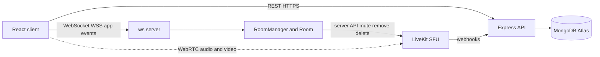
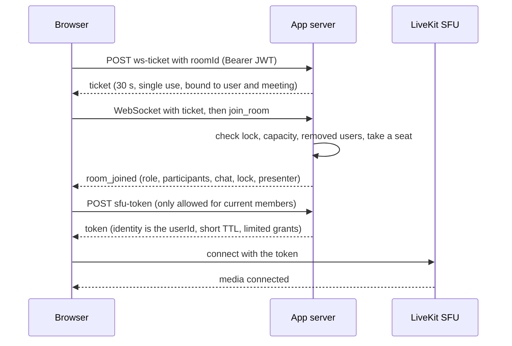
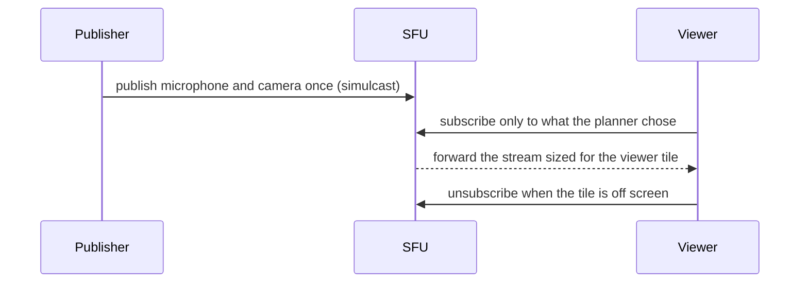
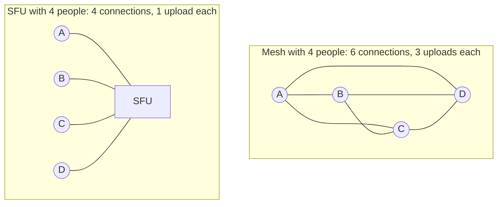
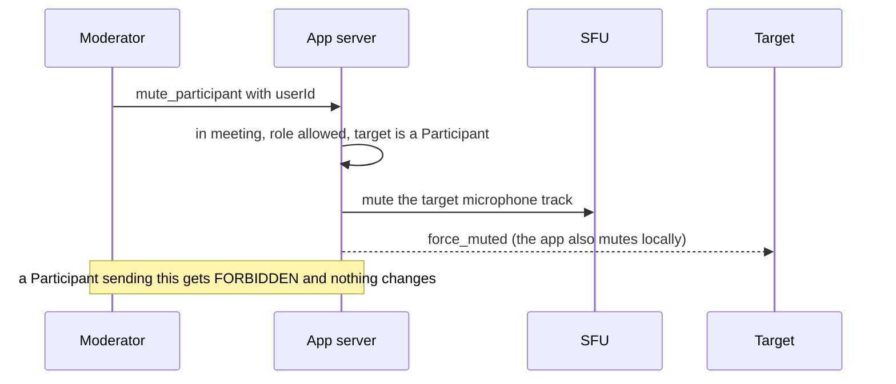
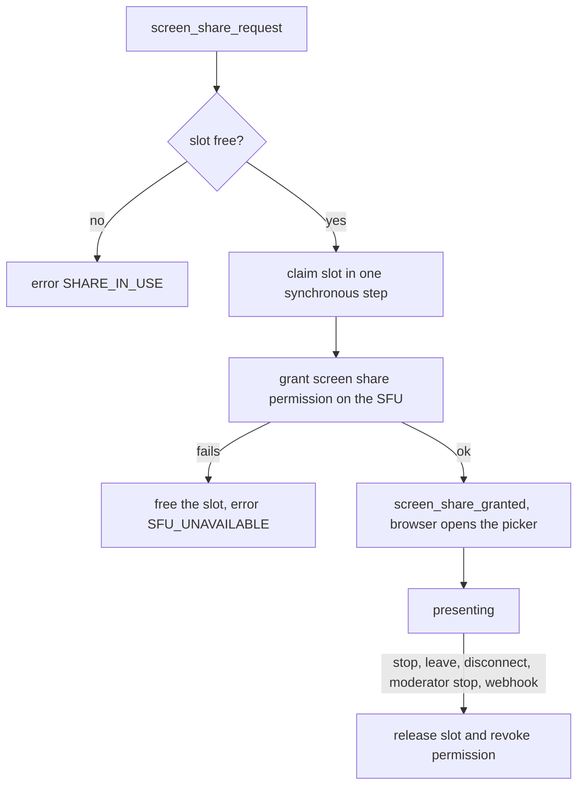

# Huddle

Video meetings with a real media server. Create a meeting, share the code, and talk with video, share your screen, chat and raise a hand. A server-side **SFU** keeps big rooms smooth, and the backend decides who may do what.


## View live

> Placeholders. Replace them after you deploy (see [docs/deployment.md](docs/deployment.md)). Nothing here has been deployed yet.

|                        | Link                                               |
| ---------------------- | -------------------------------------------------- |
| Frontend (Vercel)      | https://huddle-zeta-lemon.vercel.app               |
| App server (Render)    | https://huddle-server-u796.onrender.com            |
| App server (Reder)     | https://huddle-server-u796.onrender.com/api/health |
| App WebSocket          | wss://huddle-server-u796.onrender.com              |
| Media server (LiveKit) | wss://huddle-6fwh0lzz.livekit.cloud                |

## 🌐 View Live Button's

[](https://huddle-zeta-lemon.vercel.app/)

[](https://huddle-server-u796.onrender.com/)

## Features

- **Audio and video through an SFU** (LiveKit) with simulcast, adaptive quality and dynamic broadcast
- **Screen sharing**, one presenter at a time, enforced by the server on the media server
- **Chat**, **raise hand** with a queue, and a live **participant list** that stays smooth with 100 people
- **Roles**: Host, Moderator, Participant, enforced on the backend for every event
- **Moderation**: mute, remove, lower hands, stop a share, assign Moderators, transfer Host, lock, end for everyone, delete a meeting
- **Built for big rooms**: speaker view and paginated gallery, active speaker, pinning, and selective subscriptions so the browser never pulls 100 videos
- **Pre-join lobby** with camera preview, microphone level meter and device pickers, and a way in without a camera
- **Reconnection** for both the app WebSocket (45 s grace period keeps your seat) and the media connection
- **Dashboard** with recent meetings, invite links and confirmed delete
- Keyboard shortcuts in a meeting: `M` mic, `V` camera, `S` share, `H` hand, `C` chat, `P` people, `G` layout

## Tech stack

| Layer             | Technology                                                                                                              |
| ----------------- | ----------------------------------------------------------------------------------------------------------------------- |
| Frontend          | React 19, Vite, React Router, Axios, `livekit-client`, native browser `WebSocket`, plain CSS                            |
| Backend           | Node.js (ES modules), Express 5, `ws`, `livekit-server-sdk`, JWT, bcryptjs, Helmet, CORS, express-rate-limit            |
| Media             | LiveKit SFU (open source), WebRTC                                                                                       |
| Database          | MongoDB (Atlas in production) with Mongoose                                                                             |
| Tests             | Vitest, Supertest, real `ws` clients, jsdom and Testing Library, `@livekit/rtc-node` bots against a real LiveKit server |
| Deployment target | Vercel (client), Render (app server), MongoDB Atlas, LiveKit Cloud or a VPS (SFU)                                       |

## Architecture

The **control plane** (who is here, what they may do) and the **media plane** (audio and video) are separate.

```text
                     ┌──────────────────────────┐
                     │       React client        │
                     │  UI · state · livekit-client │
                     └──┬────────────┬───────────┘
          REST (HTTPS)  │            │  WebSocket (WSS, native)         WebRTC media
                        ▼            ▼                                      │
              ┌────────────────────────────────┐                            ▼
              │   Node.js server (Render)       │   server API    ┌──────────────────┐
              │   Express REST + ws WebSocket   │ ──────────────▶ │   LiveKit SFU     │
              │   auth · rooms · RBAC · chat    │ ◀── webhooks ── │  forwards media,  │
              │   presence · moderation         │                 │  simulcast,       │
              └───────────────┬────────────────┘                 │  active speakers  │
                              ▼                                   └────────┬─────────┘
                        MongoDB Atlas                             browsers ◀──▶ SFU
```



The WebSocket carries only app events (presence, chat, hands, moderation). It never carries media or WebRTC signaling. More in [docs/architecture.md](docs/architecture.md).

### Join sequence



### Publish and subscribe through the SFU



### Mesh versus SFU



A mesh needs `N × (N − 1) / 2` connections: 4 people need 6, 10 need 45, 50 need 1,225 and 100 need 4,950. See [docs/sfu-architecture.md](docs/sfu-architecture.md).

### A moderator mutes someone



### Screen-share presenter slot



## Roles and permissions

| Action                                                     | Host |     Moderator     | Participant |
| ---------------------------------------------------------- | :--: | :---------------: | :---------: |
| Join, leave, chat, mic and camera, raise or lower own hand | yes  |        yes        |     yes     |
| Share screen (only if the presenter slot is free)          | yes  |        yes        |     yes     |
| Mute, lower hand, stop share of someone                    | yes  | Participants only |     no      |
| Remove someone                                             | yes  | Participants only |     no      |
| Assign or revoke Moderator                                 | yes  |        no         |     no      |
| Transfer Host                                              | yes  |        no         |     no      |
| Lock or unlock the meeting                                 | yes  |        no         |     no      |
| End for everyone, delete the meeting                       | yes  |        no         |     no      |

The creator is the Host; joiners are Participants. If the Host leaves, the longest-present Moderator (else Participant) becomes Host. The UI hides what you cannot do, but **the server rejects any unauthorized event**, even one sent by hand.

## Large meetings (100 participants, honestly)

The meeting size is configurable (`MAX_PARTICIPANTS`, default 100). **The application is designed and configured for up to 100 participants per meeting at the application level. Real-world capacity depends on SFU infrastructure, CPU, memory, network bandwidth, participant devices, media configuration and the subscription strategy.** The largest test actually run was **30 headless audio bots** (and 40 did not finish in the 1-CPU build sandbox). A real 100-participant test was **not** performed.

To keep big rooms usable, the client never renders or subscribes to 100 videos: it shows the active speaker or pinned person plus a short strip, or one gallery page at a time (12 tiles), subscribes only to those, and above 25 people listens to the 10 most relevant speakers. See [docs/sfu-architecture.md](docs/sfu-architecture.md).

## Project structure

```text
huddle/
├── client/
│   ├── src/
│   │   ├── components/   VideoTile, MediaStage, ControlDock, PeoplePanel, ChatPanel, ...
│   │   ├── pages/        Login, Register, Dashboard, MeetingPage, Lobby, MeetingRoom
│   │   ├── hooks/        useRoomSocket, useLiveKitRoom, useAudioLevel, useKeyboardShortcuts
│   │   ├── meeting/      subscriptionPlanner, meetingReducer, capabilities, backoff, recovery, windowList (pure logic)
│   │   ├── context/ services/ utils/ styles/
│   ├── tests/            logic and component tests
│   ├── .env.example  vercel.json
├── server/
│   ├── src/
│   │   ├── config/ controllers/ middleware/ models/ routes/ services/ utils/
│   │   ├── websocket/    MessageHandler, RoomManager, Room, Participant, constants, protocol
│   │   ├── sfu/          SfuProvider (interface), LiveKitProvider
│   ├── tests/            unit, REST, WebSocket, and sfu/ (real LiveKit)
│   ├── scripts/          loadtest.mjs and lib/loadBot.mjs
│   ├── .env.example
├── deploy/               docker-compose.yml, livekit.yaml (templates)
├── scripts/setup-env.mjs creates the .env files for you
├── docs/                 architecture, websocket-protocol, webrtc-flow, sfu-architecture, api, deployment, requirements, interview-guide
└── README.md
```

## Quick start

Requirements: Node.js 18+, and MongoDB (a free [Atlas](https://www.mongodb.com/atlas) cluster, or MongoDB installed locally).

```bash
# 0. Create the .env files if they are missing (random JWT_SECRET). The zip you downloaded already has them.
npm run setup              # run in the project root; edit server/.env if you use Atlas. Never commit .env files

# 1. Media server (pick one)
livekit-server --dev       # download the binary from github.com/livekit/livekit/releases
#   or: docker compose -f deploy/docker-compose.yml up -d livekit   (untested here)

# 2. App server (new terminal)
cd server && npm install && npm run dev      # http://localhost:5000

# 3. Client (new terminal)
cd client && npm install && npm run dev      # http://localhost:5173
```

You should see `MongoDB connected`, `Server listening on port 5000`, and `Media server (LiveKit) reachable at ...`. If you see `WARNING: media server not ready`, LiveKit is not running or the keys do not match (see Troubleshooting). Quick check: open **http://localhost:5000/api/health/media** (it should say `"sfu":"reachable"`). Then open **http://localhost:5173**, register two users (a second browser profile or a phone on the same Wi-Fi), start a meeting in one and join it with the code in the other.

If you prefer to create the files by hand: `cp server/.env.example server/.env` and `cp client/.env.example client/.env`, then replace `JWT_SECRET` with a long random string.

### All commands

| Where     | Command                          | What it does                                                                                                 |
| --------- | -------------------------------- | ------------------------------------------------------------------------------------------------------------ |
| root      | `npm run setup`                  | create `server/.env` and `client/.env`                                                                       |
| `server/` | `npm run dev`                    | start with auto-restart                                                                                      |
| `server/` | `npm start`                      | start for production                                                                                         |
| `server/` | `npm test`                       | 76 unit, REST and WebSocket tests (no database, no SFU needed)                                               |
| `server/` | `npm run test:sfu`               | integration tests against a real `livekit-server` (downloads it once, skips with a message if it cannot run) |
| `server/` | `npm run loadtest -- --users 20` | bots through the real join flow against a running server                                                     |
| `client/` | `npm run dev`                    | dev server                                                                                                   |
| `client/` | `npm test`                       | 45 logic and component tests                                                                                 |
| `client/` | `npm run build`                  | production build into `client/dist`                                                                          |

## Environment variables

**Server (`server/.env`)**

| Variable                                | Example                            | Notes                                                                         |
| --------------------------------------- | ---------------------------------- | ----------------------------------------------------------------------------- |
| `PORT`                                  | `5000`                             | Render sets it                                                                |
| `NODE_ENV`                              | `development`                      | `production` on Render                                                        |
| `MONGODB_URI`                           | `mongodb://127.0.0.1:27017/huddle` | required                                                                      |
| `JWT_SECRET`                            | random string                      | required, 32+ characters in production                                        |
| `JWT_EXPIRE`                            | `7d`                               |                                                                               |
| `CLIENT_URL`                            | `http://localhost:5173`            | exact frontend origin, no trailing slash (CORS and WebSocket origin check)    |
| `MAX_PARTICIPANTS`                      | `100`                              | application-level capacity                                                    |
| `LIVEKIT_URL`                           | `ws://127.0.0.1:7880`              | what browsers connect to (`wss://` in production)                             |
| `LIVEKIT_API_URL`                       | `http://127.0.0.1:7880`            | what the server calls (`https://` in production)                              |
| `LIVEKIT_API_KEY`, `LIVEKIT_API_SECRET` | `devkey`, `secret`                 | the public dev defaults of `livekit-server --dev`; use your own in production |
| `SFU_TOKEN_TTL_SECONDS`                 | `600`                              |                                                                               |
| `AUTH_RATE_LIMIT_MAX`                   | `100`                              | per 15 minutes per IP; raise for load tests                                   |
| `BCRYPT_ROUNDS`                         | `10`                               | password hashing cost                                                         |

**Client (`client/.env`):** `VITE_API_URL=http://localhost:5000/api`, `VITE_WS_URL=ws://localhost:5000` (no `/api`, no path; `wss://` in production). Optional: `VITE_VIDEO_PAGE_SIZE`, `VITE_AUDIO_SUBSCRIBE_ALL_LIMIT`, `VITE_AUDIO_TOP_N`.

Never commit `.env` files (they are in `.gitignore`).

## API and WebSocket reference

REST endpoints: [docs/api.md](docs/api.md). Application WebSocket events, payloads, error codes and close codes: [docs/websocket-protocol.md](docs/websocket-protocol.md). Media flow, STUN/TURN and reconnection: [docs/webrtc-flow.md](docs/webrtc-flow.md).

## Testing

```bash
cd server && npm test            # 76 tests
cd server && npm run test:sfu    # 12 real-SFU tests (including "media down, then up") + a 12-bot load test
cd client && npm test            # 45 tests
```

- **Server tests** use real `ws` clients against the real Express and WebSocket stack. The two Mongoose models are replaced by in-memory fakes and the SFU by a recorder (fakes exist only in tests).
- **SFU integration tests** start a real `livekit-server` and use headless `@livekit/rtc-node` participants: tokens connect, real audio is forwarded, server-side mute works, removal and room deletion disconnect people, the screen-share permission is enforced, and 12 participants match the app's count.
- **Not tested** (no browser, device or network was available): the React UI in a real browser, `getUserMedia` and `getDisplayMedia`, mobile, TURN over real networks, a real MongoDB, deployment, and a real 100-person load. The status of every feature is in [docs/requirements.md](docs/requirements.md).

## Deployment

Four pieces: Vercel (client), Render (app server), MongoDB Atlas, and the SFU on **LiveKit Cloud or a VPS** (Render and Vercel cannot host an SFU: it needs UDP and TCP media ports and a public IP). Steps, environment values and the TURN setup are in [docs/deployment.md](docs/deployment.md). Deploy the SFU and server first, then set `CLIENT_URL` to the real Vercel URL and redeploy.

### STUN and TURN in one paragraph

STUN tells a browser its public address and works on most home networks. TURN relays media when no direct path exists (corporate Wi-Fi, some mobile data). Without TURN some users cannot connect. LiveKit Cloud includes TURN; when self-hosting, enable the `turn` block in `deploy/livekit.yaml`. Render cannot run a TURN server because TURN needs UDP.

## Manual test checklist

Run these yourself with two devices or browser profiles (ideally one on phone data), locally first and then on the deployed URLs:

- [ ] Register two users; one starts a meeting and the other joins with the code
- [ ] Lobby preview and level meter work; device pickers work; blocking permissions still lets you join as a viewer
- [ ] Both people see and hear each other; mic and camera toggles update on the other side
- [ ] Screen share works; a second person cannot share while the slot is taken; the Host can stop someone's share
- [ ] Raise hand shows in People with a queue number; Host or Moderator can lower it
- [ ] The Host mutes a participant (they are muted and see a toast)
- [ ] A Moderator can remove a Participant but not another Moderator or the Host
- [ ] Promote and revoke Moderator, transfer Host, lock (a new joiner is rejected), and set `MAX_PARTICIPANTS=2` to confirm the third is rejected
- [ ] Refresh the page: the same seat and role come back and the call reconnects; try airplane mode briefly and watch both status pills recover
- [ ] With 5 or more people: speaker view and gallery pagination work, and off-screen tiles stop receiving video
- [ ] The Host ends the meeting: everyone sees the ended screen and media stops
- [ ] On a different network (phone data and Wi-Fi) the call connects; if not, you need TURN
- [ ] Production: HTTPS, `wss://` for both the app and the media server, and correct `CLIENT_URL` and `VITE_*` values

## Troubleshooting

| Problem                                                                            | Likely cause and fix                                                                                                                                                                                                    |
| ---------------------------------------------------------------------------------- | ----------------------------------------------------------------------------------------------------------------------------------------------------------------------------------------------------------------------- |
| In a meeting: **"Media failed"**, toast "Cannot reach the LiveKit media server..." | LiveKit is not running (or not on that address). Start it (`livekit-server --dev`), confirm `http://localhost:5000/api/health/media` says `reachable`, then press **Retry** in the banner. No need to leave the meeting |
| Toast: "LiveKit rejected the API key or secret"                                    | `LIVEKIT_API_KEY` and `LIVEKIT_API_SECRET` in `server/.env` do not match the keys LiveKit was started with (`livekit-server --dev` uses `devkey` and `secret`). Fix the file and restart the server                     |
| Server prints `WARNING: media server not ready` at startup                         | Same two causes as above. The message says which one                                                                                                                                                                    |
| People are in the meeting (`2/100`, "Connected") but nobody sees or hears anyone   | The app WebSocket works but the media connection does not. Check the two rows above, then camera and microphone permissions in the browser                                                                              |
| Camera or microphone blocked, "needs HTTPS or localhost"                           | Allow access in the browser address bar. Outside localhost, the site must use HTTPS                                                                                                                                     |
| Works on one Wi-Fi but not between Wi-Fi and phone data                            | A direct path is not possible; you need a TURN server (see `docs/deployment.md`)                                                                                                                                        |
| `Missing required environment variables`                                           | `server/.env` is missing: run `npm run setup` in the project root                                                                                                                                                       |
| `MongooseServerSelectionError ... 27017`                                           | MongoDB is not running locally. Start it, or put your Atlas string in `MONGODB_URI`                                                                                                                                     |
| CORS error, or the WebSocket never connects                                        | `CLIENT_URL` must be the exact frontend origin (no trailing slash); `VITE_WS_URL` must be `ws://` locally and `wss://` in production, without `/api`                                                                    |
| `EADDRINUSE :::5000`                                                               | Another process uses port 5000. Close it or change `PORT`                                                                                                                                                               |

## Security

- Passwords are hashed with bcrypt and never returned. JWTs hold only the user id.
- WebSocket tickets: 30 seconds, single use, bound to one user and one meeting, kept in memory; the upgrade checks `Origin`.
- Identity, role and room membership always come from the server. Every WebSocket event passes: authenticated, in the meeting, role allowed, target valid.
- SFU tokens: only for current members, `identity = userId`, short TTL, no admin or data-publish grants, screen share withheld until the presenter slot is granted.
- Helmet, a CORS origin allow-list, rate limits on the API (`/api/auth` stricter), a 16 KB WebSocket message limit, 40 messages per second per socket, and per-user limits on chat and actions.
- Chat is rendered as plain text, so messages cannot inject HTML. Errors never expose stack traces in production.
- The webhook endpoint verifies LiveKit's signature on the raw body.

## Design decisions and trade-offs

- **LiveKit as the SFU, behind an interface.** Faster to deliver, deployable by one person, and testable without a browser. mediasoup teaches more about transports but needs native builds and hand-written signaling.
- **The app server is the gatekeeper.** Membership comes first, then a media token. The SFU never decides who is allowed in.
- **Server-authoritative state** for membership, roles, hands and the presenter slot; **LiveKit is authoritative** for mic, camera and speaking, so those are not duplicated.
- **In-memory active rooms, MongoDB for durable data**, written only on create, host change, lock change, end/delete, unload and join.
- **Single-instance app server today.** Scaling out is documented (Redis Pub/Sub, several SFU nodes), not built.

## Known limitations

- Rooms, tickets and the removed-users list live in memory: a restart drops them (meetings reload from MongoDB; the removed list resets).
- After a restart, a locked meeting only lets the Host back in until they unlock it.
- The JWT is stored in `localStorage`, which is simple but exposed to XSS; httpOnly cookies would be safer.
- No in-meeting device switcher (devices are chosen in the lobby), no recording, waiting rooms, breakouts or persisted chat.
- Calls across strict networks need TURN, which you must configure.

## Future improvements

Redis Pub/Sub and multiple app and SFU nodes, httpOnly cookie sessions, an in-meeting device switcher, a stats panel, shared notes, persisted chat, and recording.

## Documentation

- [Architecture](docs/architecture.md)
- [WebSocket protocol](docs/websocket-protocol.md)
- [WebRTC flow](docs/webrtc-flow.md)
- [SFU architecture](docs/sfu-architecture.md)
- [REST API](docs/api.md)
- [Deployment](docs/deployment.md)
- [Requirements and verification status](docs/requirements.md)
- [Interview guide](docs/interview-guide.md)

## Author

**Karan Maurya**

- GitHub: [@karanmaurya-git](https://github.com/karanmaurya-git)
- LinkedIn: [karan-maurya-4260b6293](https://linkedin.com/in/karan-maurya-4260b6293/)

## License

MIT License. Free to use, copy and modify.
